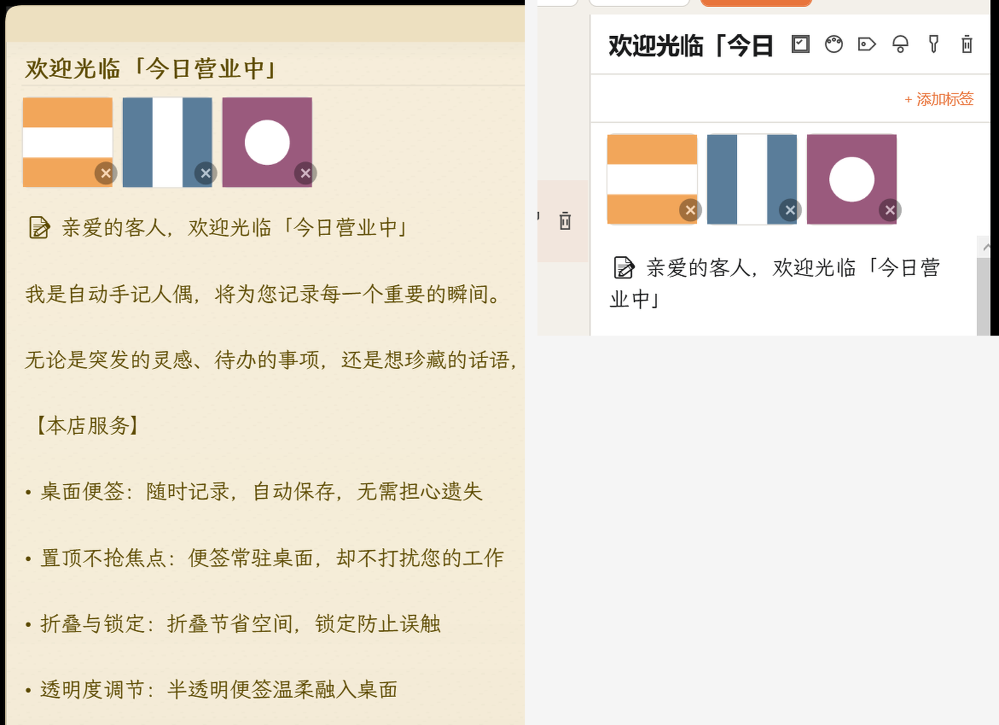
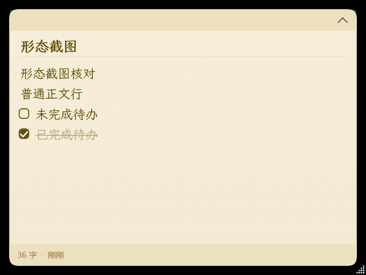

<div align="center">

# 今日营业中 · Today Open

**一款免费、开源的 Windows 桌面便签软件 —— 轻量、快速、有温度。**

[](../../releases)
[](LICENSE)
[]()
[]()

*这里是一间小小信件管理室，每一张便签都是一封信。*

</div>

---

## ✨ 功能特性

- 📝 **桌面便签**：随时记录，输入即保存，无需担心遗失
- 📌 **置顶不抢焦点**：便签常驻桌面，不打扰当前工作
- 🗂️ **折叠 / 极简 / 锁定**：折叠节省空间，极简化身桌面磁贴，锁定防止误触
- 🌈 **12 种便签色**：六个色相各分深浅，配暖色阴影与纸张质感
- ✅ **待办事项**：轻量 Markdown 语法（`- [ ]` / `- [x]`），自绘复选框
- 🔔 **提醒服务**：单次 / 每日 / 每周 / 工作日 / 每月
- 🏷️ **标签分类**：多标签整理，按颜色 / 标签 / 时间筛选，搜索关键词高亮
- 🖼️ **图片附件**：粘贴或选择图片入库，随备份自动走
- 🧲 **贴边收纳**：拖到屏幕边缘收成细条，悬停唤出（默认关闭）
- 📥 **数据导入**：JSON / Markdown / 文本导回，`VACUUM INTO` 快照备份
- 🌙 **浅色 / 深色主题**，半透明便签温柔融入桌面
- ⌨️ **全局快捷键**、系统托盘、开机自启

## 📸 截图

| 便签窗口 与 主界面编辑区 | 便签本体（纸张质感 / 待办） |
| :---: | :---: |
|  |  |

## 📥 下载

前往 [**Releases**](../../releases) 页面下载最新便携版 ZIP：

1. 解压到任意目录（无需安装、无需管理员权限）
2. 运行 `今日营业中.exe`
3. 数据存储在 `%APPDATA%\今日营业中\`，重装 / 换目录数据不丢

> 需要 Windows 10 1809+ / Windows 11，自带 .NET 运行时，开箱即用。

## 🔨 从源码构建

```bash
git clone https://github.com/suyuye/today-open.git
cd today-open

# 还原 / 构建
dotnet build Note.sln -c Release

# 运行全部单元测试（xunit，324 用例）
dotnet test Note.sln -c Release

# 发布自包含单文件
dotnet publish src/Note.App/Note.App.csproj -c Release -r win-x64 \
  --self-contained true -p:PublishSingleFile=true \
  -p:IncludeNativeLibrariesForSelfExtract=true -p:DebugType=none \
  -o publish
```

**技术栈**：C# / WPF / .NET 10（PerMonitorV2）/ SQLite / CommunityToolkit.Mvvm / xUnit

## 📁 项目结构

```
├── src/Note.App/        # 主程序（WPF，MVVM）
│   ├── Data/            #   SQLite 数据层（AppDbContext 建表 + 幂等迁移）
│   ├── Services/        #   业务服务（便签 / 备份 / 导入 / 附件 / 提醒…）
│   ├── ViewModels/      #   MVVM 视图模型（含编辑器共用基类）
│   ├── Views/           #   窗口与面板（NoteWindow 按职责拆 5 个 partial）
│   └── Helpers/         #   工具（TreeWalker / DockGeometry / 色板真源…）
├── tests/               # xunit 单元测试（324 用例 / 14 文件）
├── docs/                # 展示图片
├── installer/           # Inno Setup 脚本（可选安装包）
└── 今日营业中_完整开发文档_v1.5.3.md   # 完整开发文档（产品设计 → 打包发布）
```

## 📚 文档

- [**完整开发文档 v1.5.3**](今日营业中_完整开发文档_v1.5.3.md)：产品设计、技术方案、数据库设计、开发流程、发布全流程参考
- [更新日志](../../releases)：每个版本的修缮记录（书信体）

## 🤝 贡献

欢迎提 [Issue](../../issues) 反馈问题或建议。提交 PR 前请确保 `dotnet test` 全绿。

## 📄 开源协议

[MIT](LICENSE) © 2026 苏羽野
